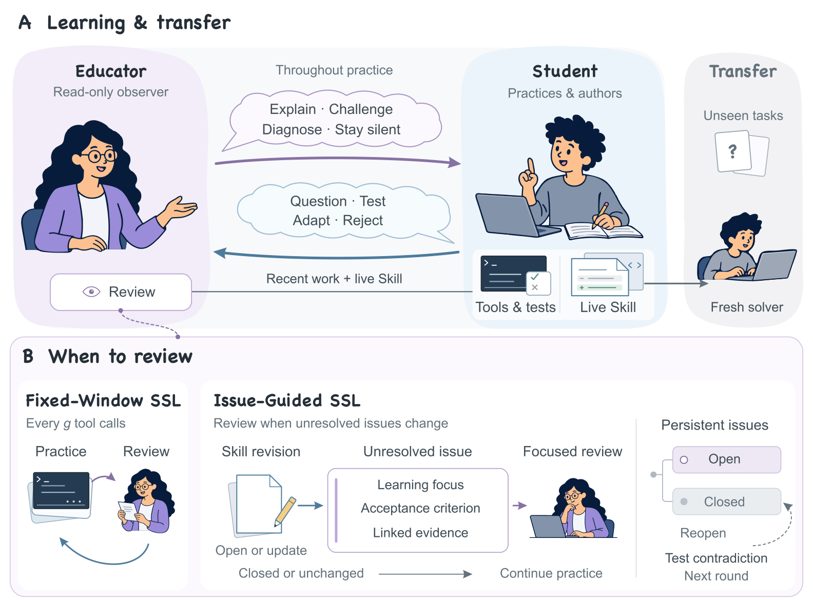

<a href="https://github.com/NJU-LINK"></a>

# Socratic Skill Learning

> **Interleaving Teaching and Practice for Transferable Agent Skills**

**[NJU-LINK](https://github.com/NJU-LINK) · Nanjing University**

<!-- TODO: Add the arXiv paper link after publication. -->

<p align="center">
  <a href="benchmark/README.md"></a>
  <a href="docs/running.md"></a>
  <a href="LICENSE"></a>
</p>

<p align="center">
  <a href="#quick-start">Quick Start</a> ·
  <a href="benchmark/README.md">SkillTransferBench</a> ·
  <a href="#results">Results</a> ·
  <a href="#citation">Citation</a>
</p>

---

## Introduction

**Socratic Skill Learning (SSL)** develops reusable agent Skills by interleaving
a Student's practice with an Educator's guidance. The Student authors the
package, which fresh solvers apply to unseen tasks.

We release:

- **[SSL](src/)** — Fixed-Window and Issue-Guided Skill learning and evaluation.
- **[SkillTransferBench](benchmark/README.md)** — 35 task families and 408 executable variants.
- **[Skills and records](experiments/README.md)** — Learned packages, scores, and Student–Educator sessions.

<p align="center">
  <a href="docs/assets/method-overview.png"></a>
</p>

[See an annotated learning run →](docs/learning-example.md)

## Quick Start

### Installation

Requires **Node.js 22.19+**, **Docker**, and an OpenAI-compatible model endpoint.

```bash
git clone https://github.com/NJU-LINK/Socratic-Skill-Learning.git
cd Socratic-Skill-Learning
npm ci
cp .env.example .env
```

Set `SSL_URL` and `SSL_KEY` in `.env` and start Docker.

### Usage

Learn and evaluate a Skill on one task family:

```bash
npm run ssl -- run --scope main --model qwen \
  --methods issue-guided-ssl --families html-finance-verify \
  --replicates 1
```

Add `--dry-run` to preview the plan without model calls.

[Evaluate a released Skill](docs/running.md#evaluate-a-released-skill) ·
[Summarize results offline](docs/running.md#recompute-the-main-results-offline)

## Results

Fixed-Window SSL improves utility over No Skill by **7.8 pp on Qwen**
(22 families), **3.1 pp on DeepSeek**, and **8.2 pp on Kimi** (10 shared families).

Issue-Guided SSL uses **61.7–77.4% fewer Educator tokens** than Fixed-Window SSL.

[Full results →](docs/results.md)

<details>
<summary>Project structure</summary>

```text
src/            Skill learning, teaching, and evaluation
benchmark/      SkillTransferBench tasks and specifications
experiments/    Learned Skills, scores, and session archives
configs/        Models and experiment scopes
docs/           Running guide, results, and learning examples
```

</details>

## Citation

[CITATION.cff](CITATION.cff)

<details>
<summary><b>BibTeX</b></summary>

```bibtex
@misc{zhu2026socraticskilllearning,
  title  = {Socratic Skill Learning: Interleaving Teaching and Practice
            for Transferable Agent Skills},
  author = {Letian Zhu and Han Li and Yifan Yao and Xinping Lei
            and Xinyu Che and Jiahao Wang and Dianyi Wang and Yucheng Fu
            and Jiakai Wang and Zhiqi Bai and Wenbo Su and Jiaheng Liu},
  year   = {2026},
  url    = {https://github.com/NJU-LINK/Socratic-Skill-Learning}
}
```

</details>

## License

**Original code:** [MIT](LICENSE). **Benchmark:** [upstream terms](THIRD_PARTY_NOTICES.md)
and [attribution](benchmark/ATTRIBUTION.md).

Runtime: [Pi](https://github.com/earendil-works/pi) · Baseline adapters:
[Trace2Skill](https://github.com/Qwen-Applications/Trace2Skill) and
[SKILL-KD](https://github.com/KhanCold/SKILL-KD).
