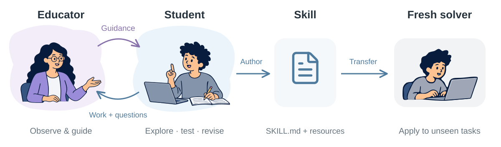
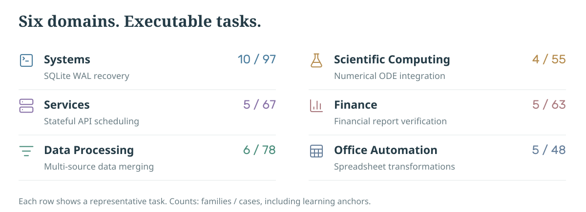
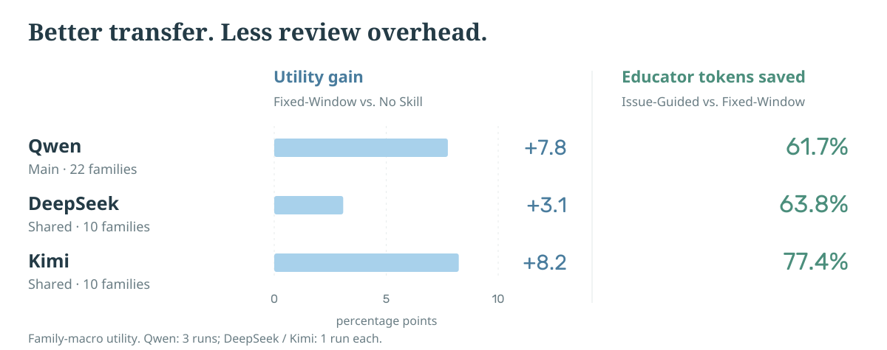

<p align="center">
  
</p>

<h1 align="center">Socratic Skill Learning</h1>

<p align="center"><strong>Interleaving Teaching and Practice for Transferable Agent Skills</strong></p>

<p align="center"><strong>NJU-LINK</strong> · Nanjing University</p>

<p align="center">
  <a href="https://arxiv.org/abs/2610.17860"></a>
  <a href="https://huggingface.co/datasets/NJU-LINK/SkillTransferBench"></a>
  <a href="docs/README.md"></a>
</p>

## Overview

**Socratic Skill Learning (SSL)** develops reusable agent Skills by interleaving
a Student's practice with an Educator's guidance. The Student authors the
package, which fresh solvers apply to unseen tasks.

Fixed-Window SSL reviews progress at regular intervals. Issue-Guided SSL
focuses review on unresolved learning issues as they change.

<p align="center">
  <picture><source media="(max-width: 640px)" srcset="docs/assets/repo-overview-mobile.svg"></picture>
</p>

<details>
<summary>Full method diagram</summary>


</details>

## SkillTransferBench

**35 task families · 408 executable cases · 6 domains.**
Public family specifications define what can vary; fresh solver sessions test
whether learned Skills transfer to held-out cases.

<p align="center">
  <picture><source media="(max-width: 640px)" srcset="docs/assets/benchmark-atlas-mobile.svg"></picture>
</p>

The main evaluation uses **22 families / 155 held-out cases**; cross-model
experiments use a shared **10-family / 77-case** subset.
Browse specifications and download executable tasks on
[Hugging Face](https://huggingface.co/datasets/NJU-LINK/SkillTransferBench).

## Results

<p align="center">
  <picture><source media="(max-width: 640px)" srcset="docs/assets/results-summary-mobile.svg"></picture>
</p>

[Full comparisons and model settings](docs/results.md).

## Quick Start

Requires **Node.js 22.19+**, **Docker**, and an OpenAI-compatible model endpoint.

```bash
git clone https://github.com/NJU-LINK/Socratic-Skill-Learning.git
cd Socratic-Skill-Learning
npm ci
cp .env.example .env
```

Set `SSL_URL` and `SSL_KEY` in `.env` and start Docker.

Learn and evaluate a Skill on one task family:

```bash
npm run ssl -- run --scope main --model qwen \
  --methods issue-guided-ssl --families html-finance-verify \
  --replicates 1
```

Add `--dry-run` to preview the plan without model calls.

The [documentation](docs/README.md) covers setup, released Skills, and offline analysis.

## Citation

<details>
<summary><b>BibTeX</b></summary>

```bibtex
@misc{zhu2026socraticskilllearning,
  title  = {Socratic Skill Learning: Interleaving Teaching and Practice
            for Transferable Agent Skills},
  author = {Letian Zhu and Han Li and Yifan Yao and Xinping Lei
            and Xinyu Che and Jiahao Wang and Dianyi Wang and Yucheng Fu
            and Jiakai Wang and Zhiqi Bai and Wenbo Su and Jiaheng Liu},
  year   = {2026},
  eprint = {2610.17860},
  archivePrefix = {arXiv},
  primaryClass = {cs.AI},
  doi    = {10.48550/arXiv.2610.17860},
  url    = {https://arxiv.org/abs/2610.17860}
}
```

</details>

## License

Original code is [MIT licensed](LICENSE). Benchmark materials retain their
[source-specific licenses and attribution](THIRD_PARTY_NOTICES.md).

<details>
<summary>Acknowledgments</summary>

Runtime: [Pi](https://github.com/earendil-works/pi) · Baseline adapters:
[Trace2Skill](https://github.com/Qwen-Applications/Trace2Skill) and
[SKILL-KD](https://github.com/KhanCold/SKILL-KD).

</details>
