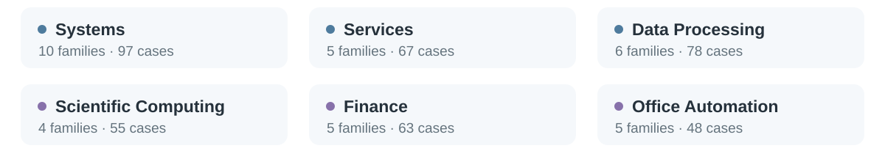

# SkillTransferBench

SkillTransferBench contains **35 task families and 408 executable variants**:
35 training anchors and 373 held-out variants. Each family is defined by its
`spec.yaml` and the concrete training task `v01`. Other variants retain that
family's task contract while changing the inputs or conditions described in
the specification. Variant numbers are preserved and may have gaps.

[Browse and download on Hugging Face](https://huggingface.co/datasets/NJU-LINK/SkillTransferBench)
· [Local family catalog](../docs/benchmark-catalog.md)



## Evaluation scopes

| Scope | Families | Training anchors | Held-out cases | Total variants |
| --- | ---: | ---: | ---: | ---: |
| [Full catalog](../configs/scopes/full.yaml) | 35 | 35 | 373 | 408 |
| [Main comparison](../configs/scopes/main.yaml) | 22 | 22 | 155 | 177 |
| [Lite cross-model subset](../configs/scopes/lite.yaml) | 10 | 10 | 77 | 87 |

The scope files specify the exact family and variant lists. The main and lite
scopes are subsets of the full catalog; the 155 and 77 counts refer only to
held-out cases.

## Find a task

Start with a family's specification, then inspect its anchor and a held-out
variant. For example:

- [html-finance-verify/spec.yaml](html-finance-verify/spec.yaml) defines the family.
- [html-finance-verify/v01/](html-finance-verify/v01/) is the training anchor.
- [html-finance-verify/v05/](html-finance-verify/v05/) is a main/lite held-out case.
- The [trajectory example](../experiments/README.md#follow-one-run) links this family to
  the Student, Educator, learned Skill, and held-out solving records.

Use the [evaluation guide](../docs/running.md) to run acquisition or evaluate a
released Skill. The harness uses this directory as its default benchmark root;
`--bench` selects another copy.

## Files in each family

```text
<family>/
├── spec.yaml
├── v01/                      training anchor
│   ├── task.yaml
│   ├── Dockerfile
│   ├── docker-compose.yaml
│   ├── ...                   task inputs and supporting files
│   ├── tests/
│   ├── run-tests.sh
│   └── solution.sh
└── vNN/                      held-out variants with the same basic layout
```

| File | Role |
| --- | --- |
| `spec.yaml` | Family contract and permitted variation axes |
| `task.yaml` | Instructions and metadata for one task variant |
| Input files and supporting directories | Fixtures, data, or services needed by that variant |
| `Dockerfile`, `docker-compose.yaml` | Task environment definition |
| `tests/`, `run-tests.sh` | Verification logic and test entry point |
| `solution.sh` | Reference solution for the variant |

Tests and reference solutions are published for inspection. During harness
evaluation, the solver works in a clean task environment and the verifier is
injected after solving. They are not part of the solver's task workspace.

<details>
<summary><b>Benchmark preparation records</b></summary>

The [source manifest](source-manifest.json), [scorer manifest](scorer-manifest.json),
and [spec audit](spec-audit.json) retain provenance and verification records
from benchmark preparation. The source manifest uses the original
`family-<name>/` paths and covers a broader, 37-family preparation inventory.
The released catalog and evaluation membership are specified by the scope
files above.

</details>

## Sources and licenses

The benchmark adapts tasks from Terminal-Bench, AgentIF-OneDay,
SpreadsheetBench, CodeContests, FullStackBench, and OfficeBench, together
with expert-and-agent construction of family variants. See
[licenses and sources](../THIRD_PARTY_NOTICES.md#benchmark-sources) for upstream
projects and terms, and [benchmark attribution](ATTRIBUTION.md) for original
task credits, source files, and modification notices. The repository's MIT
license applies to the SSL code; benchmark source materials and adaptations
retain their applicable upstream terms.
