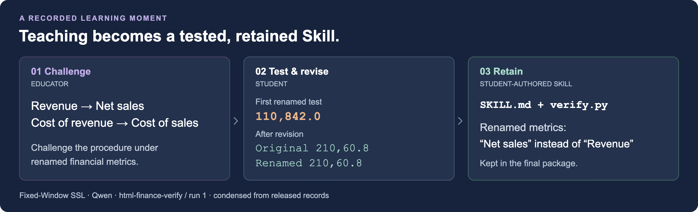

# From a teaching challenge to a reusable Skill

This example follows **Fixed-Window SSL**, `html-finance-verify`, run 1,
from the released Qwen main comparison. The task is to locate an incorrect
financial value in an HTML report and return `line_number,value`.



## 1. The Educator challenges an assumption

The fourth `educate_student` call asks how the procedure handles different
metric names:

> Scenario: A variant renames "Revenue" to "Net sales" and "Cost of revenue" to "Cost of sales".

Source: [Educator record, line 30](../experiments/main/qwen/fixed-window-ssl/r1/html-finance-verify/skill-formation/max-educator.jsonl#L30).

## 2. The Student tests and revises the procedure

The Student creates a renamed copy of the training report while preserving
its values. Its first test reports `110,842.0`, identifying the renamed
revenue metric as the error.

Source: [Test construction, line 92](../experiments/main/qwen/fixed-window-ssl/r1/html-finance-verify/skill-formation/student-author.jsonl#L92)
and [first output, line 93](../experiments/main/qwen/fixed-window-ssl/r1/html-finance-verify/skill-formation/student-author.jsonl#L93).

After debugging, the final verification gives matching outputs:

```text
--- v01 Original ---
Output: 210,60.8

--- Renamed Metrics ---
Output: 210,60.8
```

Source: [Final verification, line 163](../experiments/main/qwen/fixed-window-ssl/r1/html-finance-verify/skill-formation/student-author.jsonl#L163).
The output identifies report line 210 and the displayed value 60.8.
The renamed report is a Student-built sanity test during acquisition.

## 3. The Student retains the handling in its package

The final `SKILL.md` lists renamed metrics among the situations suited to
the reusable verifier. The bundled `verify.py` retains multiple names:

```python
revenue = find('revenue', 'net sales', 'total sales', 'net revenue', 'sales revenue')
cogs = find('cost of revenue', 'cost of goods', 'cost of sales', 'cogs')
```

Sources: [SKILL.md, line 81](../experiments/main/qwen/fixed-window-ssl/r1/html-finance-verify/skill/iteration-3/SKILL.md?plain=1#L81)
and [verify.py, line 213](../experiments/main/qwen/fixed-window-ssl/r1/html-finance-verify/skill/iteration-3/verify.py#L213).

This learning moment connects an Educator challenge, a test constructed by
the Student, practical revision, and a retained resource. The
[full run](../experiments/main/qwen/fixed-window-ssl/r1/html-finance-verify/)
contains the surrounding dialogue and Skill checkpoints.

[Experiment guide](../experiments/README.md) · [Back to the project](../README.md)
